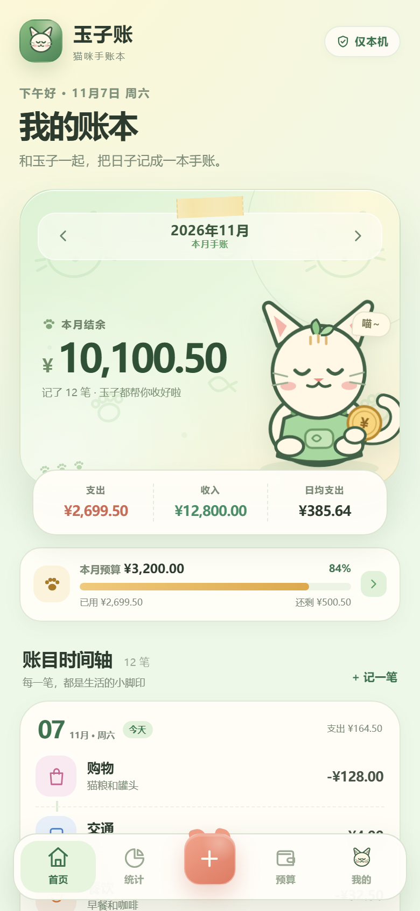
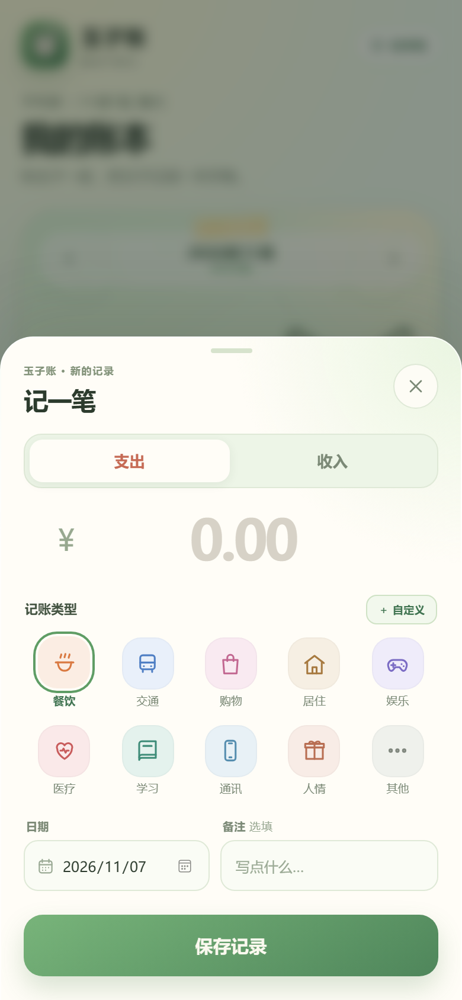
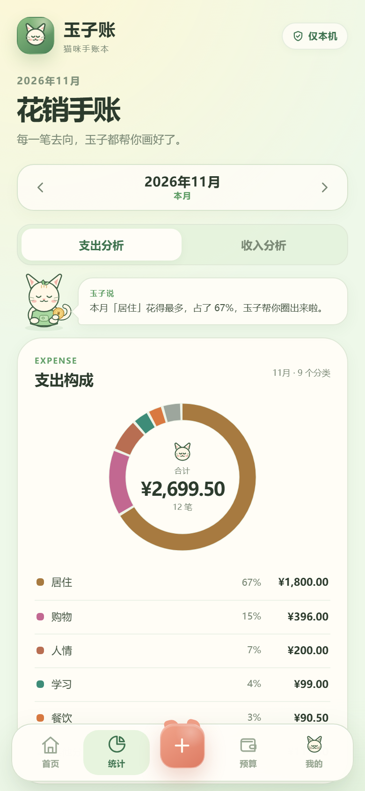
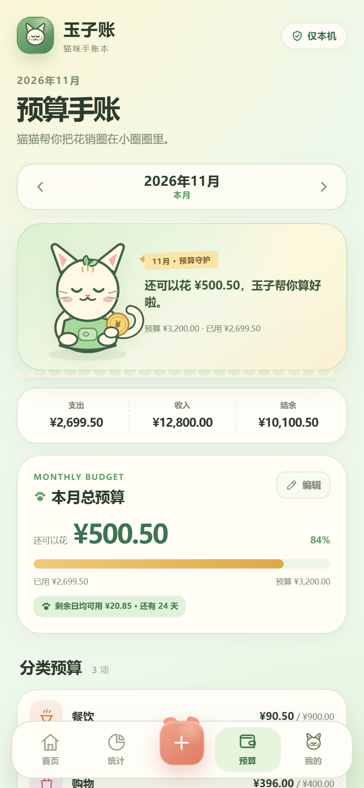
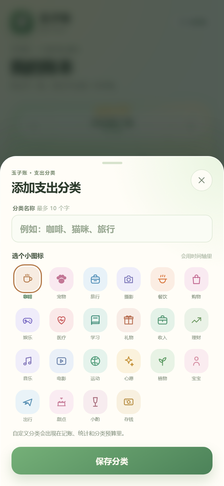
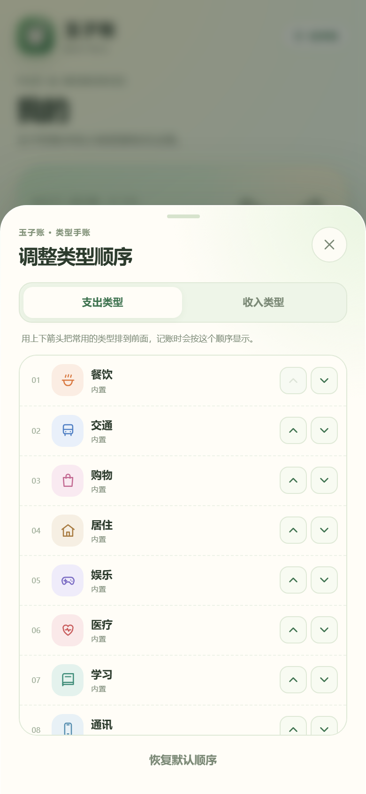

# 玉子账 · 猫咪手账本

一个面向手机的本地优先记账 PWA。和猫咪玉子一起，把每一笔收支、每一个小日子，记成一本温柔的手账。默认不需要后端，打开就能用；也可以接入自己的云同步服务，在手机和电脑之间合并账目。可添加到手机主屏幕，离线也能记账。

设计参考了 [Timi 记账](https://apps.apple.com/cn/app/timi%E8%AE%B0%E8%B4%A6/id730234563) 的时间轴记账与手账卡片结构，插画、配色和界面均为玉子账原创。

## 界面预览

| 首页 | 记一笔 |
| --- | --- |
|  |  |

| 花销手账 | 预算手账 |
| --- | --- |
|  |  |

| 自定义类型 | 调整顺序 |
| --- | --- |
|  |  |

## 已实现功能

- **时间轴记账**：金额、分类、日期、备注；按天串成手账时间轴，点击任意记录可编辑，删除后 5 秒内可撤销。
- **自定义分类**：支出和收入都可以新增自己的分类名称，支持 22 个可爱图标；在「我的 → 自定义分类」里可以改名、换图标、删除，或进入「调整类型顺序」用上下箭头排序。自定义分类超过 3 个时默认收起，只显示前 3 个，可展开查看全部。
- **自定义排序**：支出、收入分别排序，内置类型和自定义类型都能调整；记账类型、预算选择会同步顺序，并随 JSON 备份保存。点击底部加号进入记账页后，也可以点「记账类型」右侧的「↕ 排序」直接调整当前收/支类型的顺序。
- **猫咪手账视觉**：浅绿色纸感背景、猫咪纹样、原创玉子猫插画、猫咪应用图标和手账胶带细节。
- **分类统计**：支出 / 收入分类占比、分类金额与百分比，包含自定义分类。
- **同期对比**：首页显示当月截止到今天的支出/收入，与上月同一天截止的金额对比，提示多花/少花、多收入/少收入。
- **年度与区间统计**：统计页可切换「月度分析 / 年度区间」，按年查看每年收支，也可以选择起止年月查看区间合计。
- **图表报表**：环形分类图、近 6 个月收支趋势、日均支出、最大一笔。
- **预算管理**：月度总预算 + 分类预算；使用进度、剩余金额、剩余日均可用。
- **预算提醒**：达到 80% 或超支时，玉子会在应用内提醒，可关闭。
- **数据备份**：导出 JSON 完整备份、导出 CSV 表格、导入 JSON 备份或 CSV。
- **可选云同步**：邮箱 + 密码登录自己的同步服务器；自动/手动同步，按记录更新时间合并冲突，删除用墓碑标记，不会在另一台设备上被旧数据复活。
- **本机优先**：不登录云同步时，所有账目保存在浏览器 `localStorage`，不上传服务器。
- **PWA**：可安装到手机桌面，离线缓存应用界面。
- **原生壳**：`native/` 提供 Capacitor Android / iOS 工程配置，复用同一份前端；附带 GitHub Actions 构建 debug APK 的工作流。
- **移动端适配**：底部导航、猫咪加号按钮、底部弹层记账、安全区适配、数字等宽显示。

## 本地运行

在项目目录执行：

```powershell
python serve.py
```

然后浏览器打开 <http://127.0.0.1:4173>。

`serve.py` 会发送 `no-cache` 响应头，手机刷新时不会一直拿到旧页面。也可以使用任意静态文件服务器，例如：

```powershell
npx serve .
```

> 直接双击 `index.html`（`file://`）不能注册 Service Worker，建议通过本地服务器打开。

## 手机上使用

### 方式一：部署到静态托管（推荐）

把整个 `qingzhang` 目录上传到任意静态托管服务，例如 Netlify Drop、Vercel、Cloudflare Pages、GitHub Pages。项目没有构建步骤，直接发布即可。

必须使用 **HTTPS**，手机浏览器才允许安装 PWA、注册 Service Worker 和离线缓存。部署后在手机浏览器打开网址：

- **iPhone / Safari**：点击底部「分享」→「添加到主屏幕」。
- **Android / Chrome**：点击右上角菜单 →「安装应用」或「添加到主屏幕」。

### 方式二：电脑与手机同一 Wi-Fi 下临时预览

```powershell
python -m http.server 4173 --bind 0.0.0.0
```

查看电脑局域网 IP，然后在手机浏览器访问 `http://电脑IP:4173`。这种方式可以正常记账，但普通 HTTP 不属于安全上下文，**无法安装 PWA / 离线缓存**。长期使用请用 HTTPS 部署。

### 手机看到旧版本怎么办

手机浏览器和已安装的 PWA 可能缓存旧页面。优先尝试：

1. 在网址后面加一个版本参数，强制打开新文档，例如：`http://电脑IP:4173/?v=131`。
2. 打开新版本后，进入「我的 → 检查更新」，会清理旧缓存并重新加载。
3. 如果主屏幕上的旧图标仍然打开老版本，请删除旧图标，用上面的新网址重新「添加到主屏幕」。
4. 最后才考虑清理浏览器网站数据；这会一起删除本机账目，清理前务必先导出 JSON 备份。

本地预览请使用 `python serve.py`，它会为页面发送 `no-cache` 头，避免重复缓存。

## 数据说明

- 数据按「浏览器 + 网址」隔离。更换浏览器、域名或清理站点数据后，账目不会自动迁移。
- 不登录云同步时，账目只保存在本机；登录后，本地编辑会先落盘，再同步到自己的服务器。
- 换设备或清理数据前，请在「我的 → 导出完整备份」保存 JSON 文件。
- 导入 JSON 支持「合并」和「覆盖」两种方式；CSV 导入会追加记录，并跳过无法识别的行。
- 本地存储空间通常足够记录数万笔；应用会在「我的」中显示当前占用。
- 品牌升级为玉子账后沿用原有本地存储键，已有账目不会因为改名而丢失；旧版 JSON 备份也可以继续导入，并会自动补上云同步需要的更新时间字段。

## 云同步

云同步是可选功能，后端在独立的 `yuzi-cloud/` 目录中，提供注册、登录和同步 API。GitHub Pages 只能托管静态前端，不能运行 Python 后端，需要把后端部署到有持久化磁盘和 HTTPS 的服务器：

```powershell
cd yuzi-cloud
python server.py --host 127.0.0.1 --port 8787
```

然后打开玉子账 →「我的」→「云同步」→ 填写服务器地址，例如：

```text
https://your-api.example.com
```

注册并登录后，应用会在保存账目后自动同步，也可以在云同步面板里点「立即同步」。多台设备同时修改时，按记录 `updatedAt` 合并；删除会记录墓碑，避免旧设备把记录带回来。

后端部署、环境变量和 Docker 用法见 [yuzi-cloud/README.md](../yuzi-cloud/README.md)。

## CSV 格式

导出的 CSV 使用 UTF-8 BOM，Excel 可直接打开。表头为：

```csv
日期,类型,分类,金额,备注
2026-11-07,支出,餐饮,28.50,午饭
```

- `日期`：`YYYY-MM-DD`，也兼容 `YYYY/M/D`。
- `类型`：`支出` / `收入`（兼容 `expense` / `income`）。
- `分类`：使用应用中的分类名称；无法识别时归入「其他」。
- `金额`：正数，最多两位小数。

## 项目结构

```text
qingzhang/                    # 目录名沿用旧版，方便现有部署直接升级
├── index.html                # 页面骨架、猫咪 SVG 图标库、弹层
├── styles.css                # 基础设计系统
├── cat-theme.css             # 玉子账浅绿色猫咪主题
├── app.js                    # 页面渲染、交互、导入导出、PWA 安装、云同步
├── core.js                   # 纯数据逻辑：汇总、预算、CSV、备份
├── sync.js                   # 实体级冲突合并与删除墓碑
├── cloud-config.js           # 本地调试默认同步地址
├── sw.js                     # Service Worker 离线缓存
├── serve.py                  # 本地预览服务器（no-cache）
├── manifest.webmanifest      # PWA 清单
├── assets/
│   ├── app-icon.svg          # 猫咪应用图标源文件
│   └── cat-pattern.svg       # 猫咪背景纹样
├── icons/                    # 192 / 512 / maskable / Apple 图标
├── docs/screenshots/         # README 界面截图
├── native/                   # Capacitor Android / iOS 原生壳
│   ├── capacitor.config.json
│   ├── package.json
│   ├── resources/            # 原生图标 / 启动图
│   └── scripts/sync-web.js   # 把前端复制进原生 www
├── .github/workflows/        # GitHub Actions 构建 APK
└── tests/
    ├── core.test.js          # 数据层测试
    └── sync.test.js          # 冲突合并测试
```

## 原生 App

`native/` 使用 Capacitor 复用现有前端，不维护第二套界面。完整构建步骤见 [native/README.md](native/README.md)。

最省事的方式是 GitHub Actions：

1. 把 `native/` 和 `.github/workflows/android.yml` 提交到仓库。
2. 打开仓库 **Actions → Build Android APK → Run workflow**。
3. 构建完成后下载 **yuzizhang-android-debug** artifact，得到可 sideload 的 debug APK。

本地构建需要 JDK 21 + Android Studio/SDK；iOS 需要 macOS + Xcode。原生 WebView 的 localStorage 与浏览器隔离，首次使用请从网页版导出 JSON 再导入原生 App。Android 默认 origin 是 `https://localhost`，iOS 是 `capacitor://localhost`，云同步后端已把这些 origin 加入默认 CORS 白名单。

## 测试

```powershell
node tests/core.test.js
node tests/sync.test.js
```

覆盖金额解析、跨月/跨年、月度汇总、预算与超支、CSV 往返、备份合并、非法数据清洗，以及双端编辑、删除墓碑、预算/设置/分类排序冲突。

## 后续可扩展

- 多账户 / 资产、周期账单、搜索。
- 云同步的邮箱验证、找回密码、端到端加密。
- 用 Capacitor / Tauri 打包成原生 App，复用现有前端代码。
